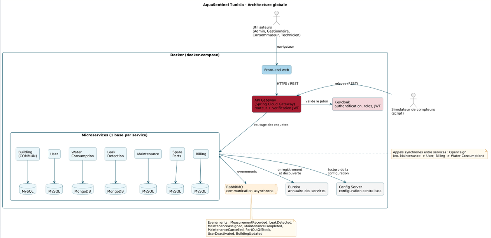
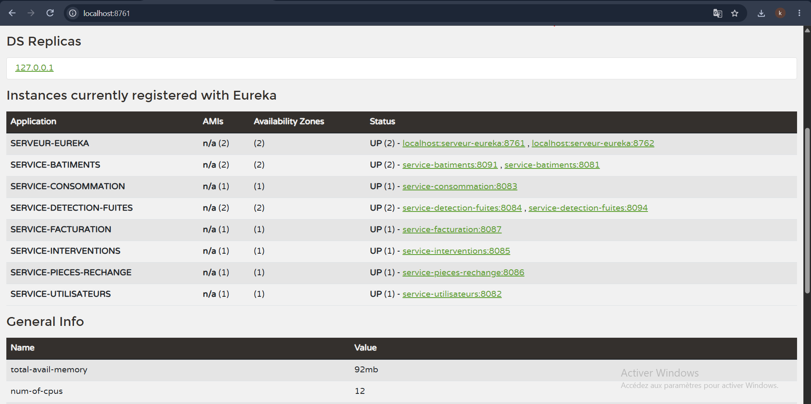
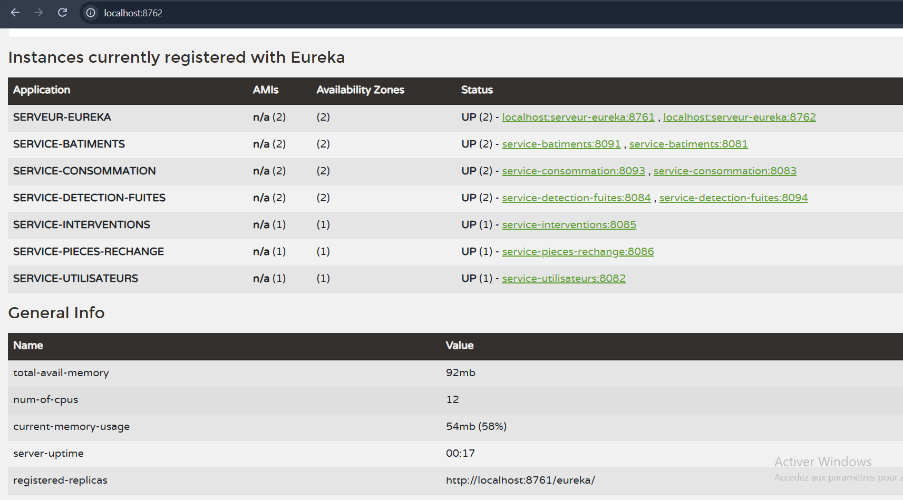

<div align="center">

# AquaSentinel Tunisia

**Suivi de la consommation d'eau et détection des fuites dans les bâtiments**


Encadrant : **Mr Ghassen Hamouda**

</div>

---

## Sommaire

1. [Contexte](#1-contexte)
2. [Équipe](#2-équipe)
3. [Architecture](#3-architecture)
4. [Microservices](#4-microservices)
5. [Service Discovery – Eureka](#5-service-discovery--eureka)
6. [Lancement du projet](#6-lancement-du-projet)
7. [Tests des API](#7-tests-des-api)
8. [Structure du dépôt](#8-structure-du-dépôt)
9. [Organisation du travail](#9-organisation-du-travail)
10. [Avancement](#10-avancement)

---

## 1. Contexte

La Tunisie fait face à un stress hydrique croissant. Dans les immeubles, les hôtels et les établissements publics, une fuite d'eau reste souvent invisible jusqu'à la réception de la facture.

**AquaSentinel Tunisia** couvre tout le cycle de traitement d'une fuite :

```
Relevé de consommation  →  Détection de la fuite  →  Intervention (technicien + pièces)  →  Facture et économies
```

Pour la démonstration, les relevés de consommation sont produits par un simulateur.

**Acteurs**

| Acteur | Rôle |
|---|---|
| Consommateur | Consulte la consommation et les factures de son bâtiment |
| Gestionnaire | Gère ses bâtiments, vérifie les fuites, suit les interventions et les factures |
| Technicien | Réalise les interventions et utilise les pièces réservées |
| Administrateur | Gère les comptes, les rôles, le stock de pièces et les tarifs |
| Simulateur | Envoie automatiquement des relevés de consommation |

---

## 2. Équipe

| Membre | Microservice |
|---|---|
| Manar Fares | User Service |
| Yasmine Maatougui | Water Consumption Service |
| Kawther Amri | Leak Detection Service |
| Loussaif Amine Bhiri | Maintenance Service |
| Balkiss Youssfi | Spare Parts Service |
| Khairi Charrad | Billing Service |
| **Toute l'équipe** | **Building Service** (service commun) |

---

## 3. Architecture

<div align="center">
  
</div>

**Principes retenus**

- **Une base de données par microservice** : aucune clé étrangère entre services ; les liens passent par des identifiants logiques (`buildingId`, `userId`…).
- **Découverte de services** avec Eureka : chaque service s'enregistre sous son nom, pas sous une adresse fixe.
- **Haute disponibilité** : deux serveurs Eureka répliqués et plusieurs instances pour les services les plus sollicités.
- **Polyglot persistence** : MySQL, PostgreSQL et MongoDB selon le besoin de chaque service.

**Évolutions prévues** : API Gateway (Spring Cloud Gateway), Config Server, sécurité Keycloak (JWT), communication asynchrone avec RabbitMQ, conteneurisation Docker Compose.

---

## 4. Microservices

| Microservice | Responsabilité | Technologie | Base | Port(s) |
|---|---|---|---|:--:|
| **Building Service** (commun) | Bâtiments, compteurs, gestionnaires, consommation de référence | Spring Boot + **GraphQL** | MySQL | 8081, 8091 |
| User Service | Comptes, rôles, disponibilité des techniciens | Spring Boot REST | MySQL | 8082 |
| Water Consumption Service | Relevés, corrections, synthèses de consommation | Spring Boot REST | PostgreSQL | 8083, 8093 |
| Leak Detection Service | Détection des fuites, niveau de risque, perte estimée, vérification | Spring Boot REST | MongoDB | 8084, 8094 |
| Maintenance Service | Demandes d'intervention, affectation, historique des statuts | Spring Boot REST | MySQL | 8085 |
| Spare Parts Service | Stock, réservation et sortie des pièces | Spring Boot REST | MySQL | 8086 |
| Billing Service | Factures par tranches et économies réalisées | Spring Boot REST | MySQL | 8087 |

**Service commun et technologie différente** : Building Service expose son API en **GraphQL** (endpoint unique `POST /graphql`). Le client choisit exactement les champs dont il a besoin, contrairement aux autres services qui exposent des API REST.

---

## 5. Service Discovery – Eureka

### Configuration

| Élément | Détail |
|---|---|
| Serveurs Eureka | 2 serveurs répliqués : **8761** (profil `peer1`) et **8762** (profil `peer2`) |
| Réplication | Chaque serveur s'enregistre auprès de l'autre ; les deux affichent le même registre |
| Clients | Tous les microservices déclarent les deux serveurs dans `defaultZone` |
| Instances multiples | **Building** (8081, 8091) et **Leak Detection** (8084, 8094) |
| Identifiant d'instance | `${spring.application.name}:${server.port}` pour distinguer les instances |

Configuration côté client (identique dans chaque microservice) :

```properties
eureka.client.service-url.defaultZone=http://localhost:8761/eureka,http://localhost:8762/eureka
eureka.instance.instance-id=${spring.application.name}:${server.port}
```

### Dashboard – serveur 8761



### Dashboard – serveur 8762



---

## 6. Lancement du projet

### Prérequis

| Outil | Version / port |
|---|---|
| JDK | 21 |
| Maven | wrapper inclus (`mvnw`) |
| MySQL (XAMPP / MariaDB) | port **3307**, utilisateur `root` |
| PostgreSQL | port **5433**, base `water_db`, utilisateur `postgres` |
| MongoDB | port **27017**, base `leak_db` créée automatiquement |

### Ordre de démarrage

**1. Serveurs Eureka**

```bash
cd Backend/serveur-eureka
./mvnw spring-boot:run -Dspring-boot.run.profiles=peer1
./mvnw spring-boot:run -Dspring-boot.run.profiles=peer2     # dans un second terminal
```

**2. Microservices** (un terminal par service)

```bash
cd Backend/<nom-du-service>
./mvnw spring-boot:run
```

**3. Seconde instance d'un service**

```bash
./mvnw spring-boot:run -Dspring-boot.run.arguments=--server.port=8094
```

**4. Vérification**

- http://localhost:8761
- http://127.0.0.1:8762

---

## 7. Tests des API

| Service | Accès | Exemple |
|---|---|---|
| Building (GraphQL) | `POST http://localhost:8081/graphql` | `{ buildings { id code name status } }` |
| Leak Detection | Swagger : `http://localhost:8084/swagger-ui/index.html` | `GET /api/leaks`, `POST /api/leaks`, `PATCH /api/leaks/{id}/verify` |
| Water Consumption | `http://localhost:8083` | voir les controllers du service |
| Maintenance | `http://localhost:8085` | voir les controllers du service |

Chaque service renvoie des erreurs normalisées : **400** (requête invalide), **404** (ressource introuvable), **409** (conflit métier).

---

## 8. Structure du dépôt

```
AquaSentinel-Tunisia-4DAS16-G5/
├── Backend/
│   ├── serveur-eureka/              Serveur de découverte (profils peer1 / peer2)
│   ├── service-batiments/           Building Service – commun (GraphQL)
│   ├── service-utilisateurs/        User Service
│   ├── service-consommation/        Water Consumption Service
│   ├── service-detection-fuites/    Leak Detection Service
│   ├── service-interventions/       Maintenance Service
│   ├── service-pieces-rechange/     Spare Parts Service
│   ├── service-facturation/         Billing Service
│   └── docker-compose.yml
├── Frontend/                        Application Angular (à venir)
├── Documentation/
│   ├── Captures/                    Captures des dashboards Eureka
│   ├── Diagrams/                    Diagrammes d'architecture et de classes
│   ├── Presentation/
│   └── Dossier_Technique_AquaSentinel.docx
└── README.md
```

---

## 9. Organisation du travail

- Une branche par fonctionnalité : `feature/<service>` ; intégration sur `feature/microservices`, puis fusion dans `main`.
- Fusion par **pull request** relue par un autre membre.
- Chaque membre travaille uniquement dans le dossier de son microservice ; le serveur Eureka et le service commun sont modifiés après accord de l'équipe.
- Messages de commit au format `feat(service): …`, `fix(service): …`, `docs: …`.

---

## 10. Avancement

| Tâche | État |
|---|:--:|
| Serveur Eureka fonctionnel | ✅ |
| Deux serveurs Eureka répliqués (8761, 8762) | ✅ |
| Tous les microservices enregistrés comme clients Eureka | ✅ |
| Deux instances de Building et de Leak Detection | ✅ |
| Service commun en GraphQL (entités, associations, CRUD) | ✅ |
| Microservices individuels (entités, associations, CRUD) | en cours |
| API Gateway, Config Server, Keycloak, RabbitMQ | prévu |
| Front-end Angular | prévu |
