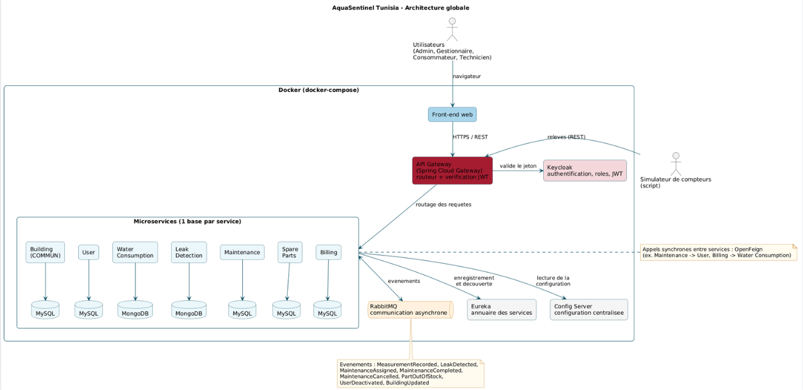

# AquaSentinel Tunisia – 4DAS16 – G5

**Surveiller l'eau, détecter les fuites, agir vite.**
Plateforme web de suivi de la consommation d'eau basée sur une architecture microservices.
Projet du module AWD – ESPRIT – Année universitaire 2026-2027 – Encadré par Mr Ghassen Hamouda.

## Problématique
La Tunisie est en stress hydrique : sécheresses répétées, restrictions et coupures d'eau.
Dans un immeuble, un hôtel ou un établissement, une fuite est souvent découverte tard, au moment de la facture.
AquaSentinel couvre le cycle complet :
**Relevé → Fuite détectée → Intervention (technicien + pièce) → Facture et économies.**
Les relevés viennent d'un simulateur pour la démonstration.

## Acteurs
- **Consommateur** : consulte la consommation et les factures de son bâtiment.
- **Gestionnaire** : gère ses bâtiments, suit les relevés, vérifie les fuites, suit les interventions et les factures.
- **Technicien** : reçoit ses interventions, utilise les pièces réservées, rédige le compte rendu.
- **Administrateur** : gère les comptes et les rôles, le stock de pièces et les tarifs.
- **Simulateur de compteurs** (acteur système) : envoie automatiquement des relevés.

## Microservices
| Microservice | Responsabilité | Base | Responsable |
|---|---|---|---|
| Building Service (COMMUN) | Référentiel des bâtiments, compteurs et gestionnaires – REST + **GraphQL** | MySQL | Toute l'équipe |
| User Service | Comptes, rôles, authentification, disponibilité des techniciens | MySQL | Manar Fares |
| Water Consumption Service | Enregistrement, historique, agrégation et correction des relevés | PostgreSQL | Yasmine Maatougui |
| Leak Detection Service | Détection des fuites, niveau de risque, perte estimée | MongoDB | Kawther Amri |
| Maintenance Service | Interventions de la fuite détectée jusqu'à la clôture | MySQL | Loussaif Bhiri |
| Spare Parts Service | Stock, réservation et sortie des pièces | MySQL | Balkiss Youssfi |
| Billing Service | Factures par tranches, majorations et économies | MySQL | Khairi Charrad |

6 microservices individuels + 1 microservice commun (Building) développé par toute l'équipe avec la technologie avancée **GraphQL**.

## Architecture


- **Front-end** Angular → **API Gateway** (Spring Cloud Gateway), point d'entrée unique
- **Eureka** (découverte), **Config Server** (configuration centralisée), **Keycloak** (sécurité, JWT, rôles)
- Communication synchrone : **OpenFeign + Resilience4j** ; asynchrone : **RabbitMQ**
- **Une base de données par microservice**, aucune clé étrangère entre les bases
- Conteneurisation : **Docker + Docker Compose**

## Principaux événements (RabbitMQ)
| Événement | Producteur | Consommateurs |
|---|---|---|
| MeasurementRecorded | Water Consumption | Leak Detection |
| LeakDetected | Leak Detection | Maintenance |
| MaintenanceAssigned | Maintenance | User |
| MaintenanceCompleted / Cancelled | Maintenance | User, Leak Detection, Spare Parts, Billing |
| PartOutOfStock | Spare Parts | Maintenance |
| BuildingUpdated | Building | Water Consumption, Leak Detection, Billing |
| UserDeactivated | User | Building, Maintenance |

## Technologies
Angular · Java + Spring Boot (Maven) · GraphQL (Spring for GraphQL) · Spring Cloud Gateway · Eureka · Config Server · Keycloak · OpenFeign + Resilience4j · RabbitMQ · MySQL · PostgreSQL · MongoDB · Docker · OpenAPI / Swagger · Git + GitHub Projects

## Structure du dépôt
```
AquaSentinel-Tunisia-4DAS16-G5/
├── Backend/
│   ├── serveur-eureka/  serveur-config/  passerelle-api/
│   ├── service-batiments/          (COMMUN)
│   ├── service-utilisateurs/
│   ├── service-consommation/
│   ├── service-detection-fuites/
│   ├── service-interventions/
│   ├── service-pieces-rechange/
│   └── service-facturation/
├── Frontend/
├── Documentation/
│   ├── Presentation/
│   ├── Diagrams/
│   └── Dossier_Technique_AquaSentinel.docx
└── README.md
```

## Lancement (prévu)
Ordre : `serveur-eureka` → `serveur-config` → microservices → `passerelle-api`
```bash
cd Backend/<nom-du-service>
mvn spring-boot:run
```
Ou avec Docker :
```bash
cd Backend
docker compose up --build
```

## Organisation du travail
- Une branche par tâche : `feature/<service>-<tâche>`
- Pull request relue par un autre membre avant la fusion
- Chaque membre commite sur son propre microservice
- Suivi des tâches : **GitHub Projects (Kanban)**

## Équipe
Loussaif Amine Bhiri · Kawther Amri · Balkiss Youssfi · Manar Fares · Yasmine Maatougui · Khairi Charrad